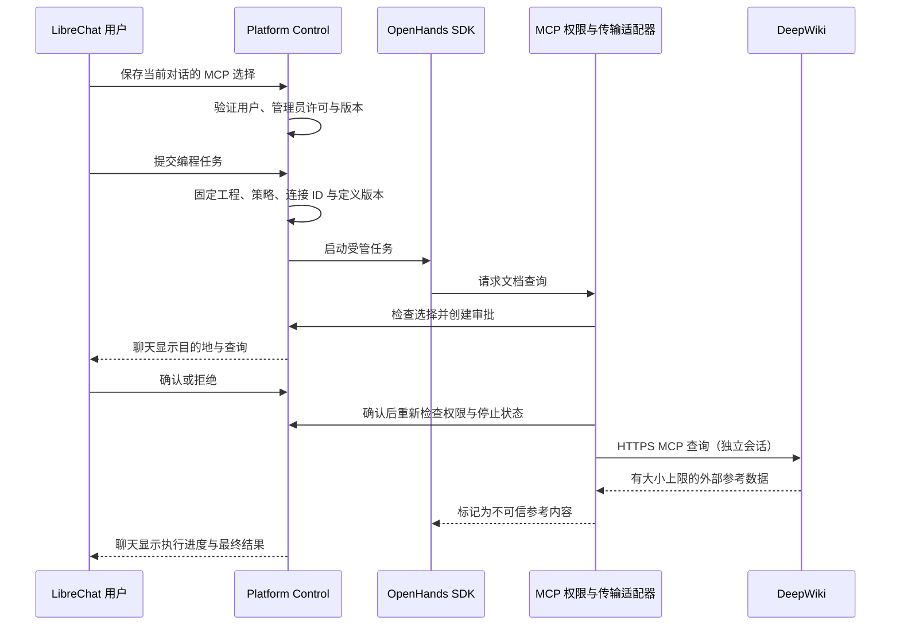

# OpenHands MCP 使用与安全设计

更新：2026-11-05。适用于星桥定制 LibreChat、Platform Control 和共享 OpenHands SDK 执行器。

## 用户如何使用

1. 在 LibreChat 左上角选择 OpenHands 编程助手，打开“编程设置”。
2. 选择自己的工程目录；在“MCP 工具”中勾选 **DeepWiki · 公开代码文档**。
3. 展开“查看工具与数据权限”，阅读目标地址、工具列表和数据外发说明，然后保存设置。
4. 在聊天中提出需求，例如：“用 DeepWiki 查一下 fastapi/fastapi 的文档结构，说明依赖注入应阅读哪部分，不要修改文件。”
5. 聊天会展示外部服务、工具和完整查询参数。确认后才发送；也可以拒绝或停止任务。
6. 执行进度、最终答复直接显示在聊天里；查询返回内容可在折叠的执行步骤中查看。

设置按用户和对话保存；任务开始时固定配置。修改勾选影响下一次任务，不给正在执行的任务追加权限。未选择 MCP 时，不给模型注册对应工具。普通聊天不使用这一组编程工具。

当前连接只查询**公开 GitHub 仓库**，不读取私有仓库。外部服务会收到批准的仓库名和问题；平台不会自动上传工程文件、用户身份、聊天历史或模型密钥。模型提出的问题仍可能包含它从上下文提取的信息，所以每次外发都必须人工检查并确认，不能把它当作自动防泄漏系统。

## 管理员如何管理

在 Platform Control → 平台管理 → **编程 MCP 连接** 中，允许或停用已审核的连接，点击“保存 MCP 配置”。用户仍需自行勾选，发布配置不会替用户授权。

关闭不依赖 LiteLLM 在线：专用配置接口直接更新已有版本化 AI 配置。保存有并发版本检查，冲突需刷新。配置操作写入 `mcp.policy.updated` 审计事件；任务创建、操作提议和审批同样有审计记录。

停用后，等待审批的任务会在发送前再次检查；正在查询的任务每秒检查停用/停止状态并关闭本地连接。已经发送给外部服务的数据不能撤回，也不能保证第三方终止已经收到的只读查询。

本版采用**代码审核的连接目录**，不是任意 URL 编辑器。新增连接需要评审其数据用途、身份归属、工具参数、外部副作用和网络范围，再经 GitOps 发布。当前只上线 DeepWiki；Context7、私有 GitHub、带 OAuth 的工具未接入，不能在界面中填写密钥来绕过审核。

## 数据与调用路径

OpenHands SDK 为 **1.58.1**，MCP Python SDK 为 **1.30.0**，采用 Streamable HTTP。通过自定义 `DocumentationTool` 接入 MCP 客户端，复用平台审批，不直接把原始 `mcp_config` 注入共享 Agent。工具定义、用途说明和输入结构由平台维护；远程返回的工具描述不作为系统指令。

现有文件操作、Kata 命令、应用发布保持原通道。MCP 不挂载工程 PVC，不获得工作节点、Kubernetes、Harbor、PostgreSQL、MinIO 或 LiteLLM 凭据。**Kata 隔离的是用户命令执行，不是远程 MCP 服务**；远程服务的信任边界在外部服务方。

## 当前开放的能力

| 项目 | 规则 |
| --- | --- |
| 连接 | `deepwiki`，`https://mcp.deepwiki.com/mcp`，定义版本 1 |
| 工具 | `read_wiki_structure`、`read_wiki_contents`、`ask_question` |
| 输入 | `owner/repository`；问答额外允许最多 2000 字符的问题；拒绝额外参数 |
| 操作权限 | 仅公开文档读取。计划/审查模式也可使用，仍需逐次审批 |
| 凭据 | 无；每次调用独立会话，无跨用户 token、cookie 或 OAuth 缓存 |
| 审批 | 每次外发均确认；“工程内自动执行”不免除 MCP 确认 |
| 网络 | 固定 HTTPS 端点及路径；无代理、任意 URL、重定向、私网地址或本地进程 |
| DNS | 每次连接解析并检查全部结果，连接固定到已验证的公网 IP，同时保持原域名 TLS/SNI 验证 |
| 集群出口 | 执行器增加公网 TCP 443；排除私网等范围。标准 NetworkPolicy 不能按域名过滤，域名限制由适配器执行；原有受管内部服务访问保留 |
| 时限 | 每次最多 60 秒，可用 `PLATFORM_AGENT_MCP_SECONDS` 配置为 5–120 秒 |
| 次数 | 每任务最多 8 次，可用 `PLATFORM_AGENT_MCP_CALLS` 配置为 1–20 次 |
| 响应 | 每条 HTTP 响应最多 256 KiB；仅文本提供给模型，最多 12000 字符并标注截断；执行记录展示尾部最多 8192 字符 |
| 失败 | 返回安全错误信息；不自动重放。再次调用仍需新的审批，受任务次数限制 |
| 额外能力 | 不提供 roots、sampling、elicitation、资源读取、图片跟随、任意 stdio 或外部写入工具 |

第三方内容可能含提示注入。平台将返回值标记为不可信资料，文件/命令/部署仍受原网关审批约束；这不是对模型不会误用参考资料的绝对保证。当前“工程内自动执行”本身允许项目修改与命令，请按工程用途选择。

## 接口约定

- `GET /internal/v1/workspace/agent/mcp`：验证 LibreChat 桥接身份后返回已审核目录和管理员启用状态，不返回凭据。
- `PUT /internal/v1/workspace/agent/preferences`：新增 `mcp_servers: string[]`，默认空；拒绝未知、重复和已停用连接。保留原 `revision` 乐观锁。
- `GET/PUT /v1/admin/ai/mcp`：管理员读取/保存 `{revision, servers: [...]}`，与 AI 策略共用版本化配置；无需数据库表变更。
- LibreChat 仅代理固定 `/api/user/workspace/agent/mcp` 路径，用户身份由服务端已验证登录取得。
- 任务新增冻结的 `mcp_versions`；聊天任务事件新增 `mcp_started`、`mcp_result`，审批操作名为 `mcp_read`。

接口契约：[`contracts/openapi.json`](../contracts/openapi.json)。无数据库模式变更，仍使用 `0015_agent_tasks`。

## 运维与验证

现有任务不因升级而自动重放。更新共享执行器前检查活动任务，等待空闲；意外重启仍按既有逻辑标为中断。

本地权限和网络边界测试：`tests/test_agent_mcp.py`。固定 SDK 适配测试：`scripts/agent_sdk_smoke.py`，在执行器镜像中运行。故障模拟：`postman/simulations/mcp-docs.sim.yaml` 与 `scripts/test_mcp_simulation.py`，只用合成数据。模拟运行时必须显式提供 `MCP_SIMULATION_URL`；生产路径没有这个地址覆盖开关。

回滚时先在管理员界面停用连接并等待活动任务结束；可先恢复旧执行器，保留当前 API 和前端读取已有记录。旧版 LibreChat 桥接层严格拒绝 MCP 偏好字段，因此不要直接混用新 API 与旧前端；完整降级需要先提供剥离新字段的兼容路径并验证设置保存。发布顺序为 API 与执行器就绪后更新前端，切换期间如保存失败可刷新后重试。

协议与服务依据：[OpenHands MCP](https://docs.openhands.dev/sdk/guides/mcp)、[MCP Streamable HTTP 2025-11-25](https://modelcontextprotocol.io/specification/2025-11-25/basic/transports)、[DeepWiki 官方连接与工具说明](https://docs.devin.ai/work-with-devin/deepwiki-mcp)。上线验收另记，不把模拟通过当作真实服务保证。
