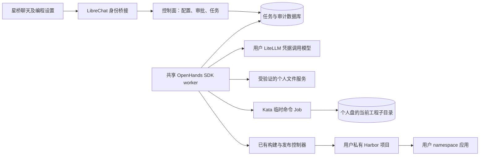

# 编程工作台与执行边界

状态：2026-11-04 已启用共享执行路径；使用指定现有用户完成生成代码、测试、构建、推送、部署和访问验收。已有个人数据和应用保持原状。适用范围仍为内部可信用户。

## 选定架构

LibreChat 的模型入口保留，增加当前工程和编程设置。配置存入控制面，任务启动时冻结配置；模型选择不能改变用户身份、执行权限或套餐。

OpenHands SDK 在共享的可信编排服务运行，只注册远程工程工具，不注册本地终端、本地文件编辑器或用户提供的 stdio MCP。工具中的命令使用独立 Kata Job 执行，只挂载当前工程子目录，无平台、模型、文件服务凭据和 Kubernetes 令牌。文件服务仍保留个人盘，但移除旧的同 Pod Agent。执行结果与审批事件由控制面持久化，浏览器刷新不重新提交任务。

个人盘是持久资产；任务 Job 是临时计算资源。单用户串行，任务完成/取消后清理 Job，PVC 不进入任务清理流程。Job 使用 UID/归属验证；创建结果不明先观察同一任务标识，绝不换名字重放命令。

## 首批开放配置

- 模型：沿用后台允许目录，聊天和编程分别记忆。
- 工程：必须选择已存在的非根目录；支持新建目录；路径不能穿越或跟随符号链接。
- 工作方式：实现、先规划、只读审查。规划与审查仅注册读取能力，没有命令或写入通道。
- 审批：严格确认默认；工程内自动执行为明确的限域授权，发布/停服/删除/数据库申请以及带数据库或对象存储连接的命令仍须确认。首批不把 LLM 自报风险当成授权依据，不宣传未验收的智能风险审批。
- MCP：已接入管理员可停用的审核目录和受控远程查询适配器，用户按对话选择。仍不开放任意 URL、命令或共享凭据输入。边界与接口见 [MCP 使用与安全设计](agent-mcp-guide.md)。

## 接口契约

- GET/PUT `/internal/v1/workspace/agent/preferences`：当前身份下的会话配置；PUT 带配置版本，拒绝覆盖并发修改。
- GET `/internal/v1/workspace/agent/tasks`：当前用户最近任务、执行配置、事件及待确认操作，不返回密钥或模型内部推理。
- POST `/internal/v1/workspace/agent/tasks/{id}/decision`：批准/拒绝具体操作标识；内容变化、过期、非所属用户均不能复用批准。
- POST `/internal/v1/workspace/agent/tasks/{id}/cancel`：停止后续执行，清理已记录的任务计算资源，不删除源文件。
- `/agent/v1/chat/completions` 的编程路径创建幂等任务并订阅结果；断开订阅不代表取消。普通聊天保持原路径。

审批、执行记录与普通 API 均按验证后的身份查询。任务内容和工具参数加密存储，不进入公共运行日志。旧的同 Pod Agent 已从个人文件服务移除；共享 worker 的用户命令权限通过逐用户 namespace RoleBinding 授予，没有任意命名空间的 ClusterRoleBinding。

## 数据与执行流程

使用 OpenHands SDK 1.58.1 的 Agent、Conversation、自定义 ToolDefinition 与 interrupt 能力。实现/规划/审查是平台定义的能力集合，不冒充 SDK 原生策略目录。SDK 自带本地终端未注册；可信 worker 不挂载用户源码。每条命令都是新进程和新 Kata Job，文件持久，进程和 shell 状态不持久。

当前共享 worker 为单副本、2 个执行槽；每个用户最多一个活动任务。命令最长 180 秒、整项任务最长 30 分钟、批准有效期 15 分钟。等待审批会占用执行槽，后续扩容应改为可恢复调度；不要直接增加 worker 副本，当前启动恢复逻辑面向单副本。

配置在任务创建时冻结。关闭页面不取消任务；需要在执行记录中明确停止。执行器重启标记任务中断，不恢复 SDK 内存状态，不重放写入。已提交的应用发布由独立控制器继续观察。查询超时重试同一 Job；创建结果不明确先按同一名称核验。Job 的 UID 校验、前台删除、后台补偿与 TTL 共同处理计算资源，PVC 永不纳入任务清理。

文件读取工具对超过 32 KiB 的文件明确要求分段检查，不静默截断后诱导完整覆盖。文件写入使用读取版本的 ETag。依赖放在工程 `.venv`/`.cache`，计入个人盘；源码构建快照排除这些目录。运行与构建容器内的临时根盘不是完整的用户存储计量，跨服务硬配额仍是独立待办。

数据库/对象存储连接只在明确请求并确认的命令中注入，不能申请任意 Secret。对象凭据目前属于该用户，并非每工程独立 IAM 凭据；工程前缀不是用户内工程之间的强隔离边界。个人盘同一用户的多个工程也不作为互不信任的租户。网络策略允许必要的 DNS、公共 HTTP/HTTPS 下载、Postgres 与 MinIO 连接；拒绝模型网关和 Kubernetes API 的实测记录见验收文档。

终端展示已执行命令的结果、退出码和文件操作；任务运行中不是交互式终端，也不展示模型内部思维链。2026-11-05 起，新任务在原助手回复中持久保存任务引用，聊天内完成审批、进度观察及最终结果展示。关闭 SSE 不取消任务；所有者限定的查询恢复显示，后续模型请求批量补齐真实结果。详见[聊天任务协议](agent-chat-contract.md)。旧版纯提示消息不猜测关联。

## 升级与回退

先备份并执行 `0015_agent_tasks`，再部署 API、worker 与前端。不要在活动任务中升级 worker；先等待完成或经用户操作停止。配置、镜像摘要和准入规则通过 ops/Argo CD 发布。回退镜像不回退或删除用户 PVC；关闭功能前应停接新编程任务。旧同 Pod Agent 执行权限更宽，不能只改开关就视为等效安全回退。

## 验收

工程 A 命令不能读写工程 B；执行环境中没有模型或平台凭据；非所属用户不能读取/审批任务；审批重复提交只执行一次；刷新页面能继续观察和审批；拒绝后不执行；只读策略没有写入工具；命令失败/超时/取消均清理计算资源；生成文件、运行测试、构建发布和实际访问仍可从用户界面完成。

网络策略需同时检验 Pod IP 和 Service IP，区分现有 PodCIDR/Calico 地址差异与实测问题，变更 CNI/节点网络前保留回滚配置，不在功能迁移中盲目重建网络。
