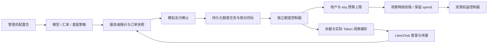
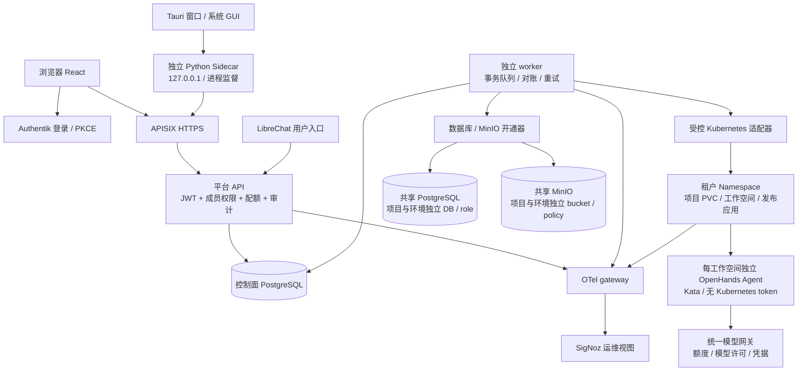
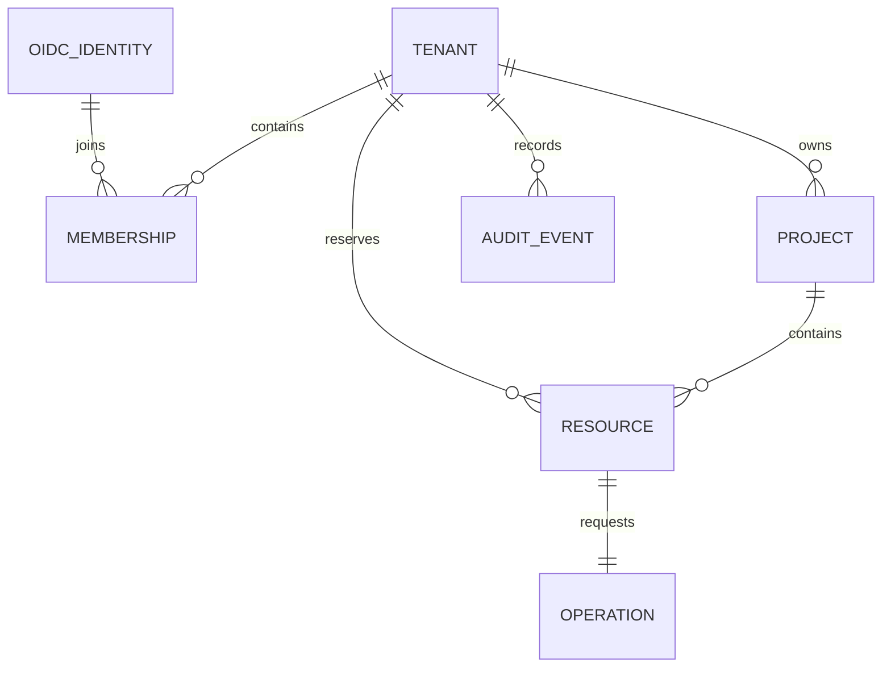
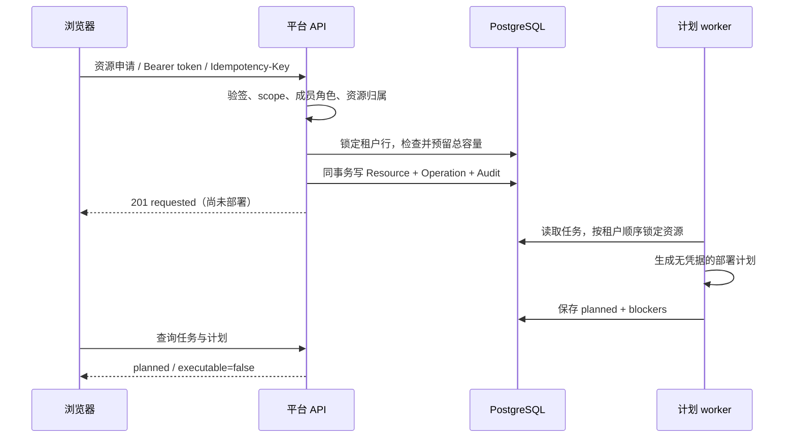

# 平台架构设计

状态：2026-11-02，内部可信用户试用。浏览器为主、桌面可选。普通用户入口已改为 LibreChat，平台控制面负责统一身份关联、个人空间和应用任务及审计；原有计划接口仍保留。实际交付范围见 [应用验收](application-delivery-acceptance-20261102.md)，下面保留的目标组件不应视为全部已上线。

当前编程/发布路径：LibreChat 主聊天 → 平台编程网关 → 用户 Kata 执行环境中的 OpenHands SDK → 同一份个人持久文件。发布请求只生成后台意图：应用控制器 → 独立 Kata BuildKit Job → 个人私有 Harbor project → 用户 namespace 中按 digest 部署 → APISIX 独立应用域名。共享的是平台入口、编排和模型网关；没有为每位用户部署完整 OpenHands Web 服务。

2026-11-03 补充：聊天能力与真实模型分离。普通聊天直接转发至 LiteLLM；编程由 OpenHands 使用用户的同一受管 key 调用选定模型。能力、两种模型选择均保存在原对话，切换保留上下文。管理员模型与套餐策略存于 PostgreSQL，普通用户通过同源接口获得真实模型目录，不看到供应商管理密钥。

注册赠送仅一次；后续购买按订单汇率把人民币额度折为美元预算。任务恢复、重复确认和重复购买不能清空历史消费。外部预算漂移需人工核验。各类存储分类计量和分类额度继续保留，本阶段不实现跨服务统一硬配额。详见[模型与套餐手册](model-membership-guide.md)。

## 1. 选型与职责

采用 Python FastAPI + SQLAlchemy + PostgreSQL 编写业务后端，React + TypeScript 编写浏览器界面。复用已有 Python 工程；当前不引入第二套 Go 服务。Python 服务可作为容器运行，桌面辅助后端可用 PyInstaller 打包成各平台独立可执行文件。PyInstaller 是打包，不是将 Python 业务嵌入 Rust。

服务端 API 是权限的最终执行点。worker 负责基础设施操作；浏览器、Open WebUI、OpenHands、Tauri 都不能直接作为授权依据。用户身份以 `(OIDC issuer, subject)` 为主键，不以用户名或邮箱作为归属依据。

目前实现 API、元数据、计划 worker 和计划生成器；图中实际开通适配器、模型网关、Agent 会话网关以及用量采集尚未连通。当前集群 OpenHands 是独立验证实例。

### 用户入口与管理入口

当前 React 页面是用于内部验证的资源申请控制台，同时展示项目、资源类型和额度，面向普通用户还不够直观。它尚不是完整的 AI 开发工作台。

后续面向普通用户的入口以“我的项目”为中心，提供与 Agent 对话、文件编辑、运行与测试、查看结果、发布及已发布应用管理；用户能看到与自己有关的用量和状态。租户、成员、额度、审计与平台运行情况放到独立的管理员界面，并按角色显示相应功能。界面隐藏按钮只改善体验，所有操作仍必须由服务端验证身份、归属和权限。

用户入口已确定采用 LibreChat，Open WebUI 不再作为目标入口。LibreChat 已部署并接入 Authentik 登录，但图中 LibreChat 到平台 API 的可信用户身份传递尚未实现；Agent 会话必须绑定到经过授权的项目和独立工作空间。上述项目工作台与完整管理员界面仍为目标设计。

正在实施的 LibreChat 项目入口使用独立 OIDC 授权码和 PKCE 流程取得控制面访问令牌；LibreChat 服务端只向已登录用户返回自己的 OIDC issuer/subject，浏览器将其与新授权的 ID token 对比，不一致时拒绝显示项目。控制面仍独立验证访问令牌、成员和租户，绝不接受前端提供的用户身份作为权限依据。接口和页面尚待新镜像与真实浏览器验收，不能据源码存在就标记为上线。

## 2. 现有组件的复用

| 已有组件 | 平台中的职责 | 集成边界 |
| --- | --- | --- |
| Authentik | 注册、登录、密码/MFA、签发访问令牌 | 平台保存成员关系；身份组仅映射平台管理员 |
| LibreChat | 普通用户统一入口 | 未来通过可信用户授权调用平台；不共享管理员 token，不直接分配资源 |
| OpenHands | 代码编辑、执行命令、测试和工具调用 | 每个工作空间单独实例/凭据；不能复用共享 Canvas 作为多租户 Agent |
| Kata | 用户代码运行时 | 所有用户代码 Pod 显式指定 RuntimeClass；启动失败不能退回 runc |
| agent-sandbox | 后续工作空间生命周期抽象 | 第一阶段适配原生资源；通过 provider 接口替换为 Sandbox/Claim，不能让两个控制器同时管理 Pod |
| Capsule | 后续租户 namespace 管理和运维约束 | 不替代平台业务授权；启用时明确 namespace 所有权及管理员访问 |
| PostgreSQL / CNPG | 控制面元数据、项目数据库 | 控制面独立 DB/role；开通器凭据与用户运行凭据分离 |
| MinIO | 项目对象、构建产物和备份 | 项目/环境独立 bucket 与有限权限凭据 |
| Harbor | 镜像、构建产物 | 发布只接受允许仓库内的不可变 digest |
| APISIX / cert-manager | HTTPS、项目域名、WebSocket 路由 | 控制面生成路由；用户不能提交任意 upstream 或域名 |
| Longhorn | 工作空间和服务持久卷 | PVC 归属不可由客户端指定；单节点不提供节点级高可用 |
| Argo CD | 平台自身及基础组件 | 管理稳定部署；动态租户资源由 worker 独占管理，避免相互覆盖 |
| OTel / SigNoz | 日志、指标、链路和运维告警 | 用户使用平台聚合视图；不能默认获得全局 SigNoz 查询权限 |

## 3. 数据模型

- `Tenant`：用户的资源总账，默认每个用户可创建一个个人租户；可加入其他租户。所有项目、工作空间、测试、部署和对象存储容量归入同一账本。
- `Membership`：owner / admin / developer / viewer。成员操作在服务端验证；平台管理员仅在显式管理接口中获得跨租户能力。
- `Project`：项目名、租户归属。成员目前为租户级共享项目；未来若需要同租户内部隔离，引入 ProjectMembership 后再开放，不通过隐藏菜单实现。
- `Resource`：workspace / agent / database / bucket / deployment。含租户和项目外键、受控 spec、申请容量、幂等键与状态。API 必须将 project_id 与 tenant_id 一起查询。
- `Operation`：资源开通任务，与资源申请在同一个事务写入。当前 worker 只把 pending 转为 planned，不修改基础设施。
- `AuditEvent`：主体、租户、操作、目标、时间。当前写入成功的控制面操作；没有实现全部文件行为记录或全量拒绝事件归档。

后续增加 Build、Release、AgentSession、UsageSample、LedgerEntry 和 SecretReference。密码、完整 token、模型密钥、源码文件内容及用户 prompt 不进入普通审计或计划文档。

## 4. 租户与工作空间

初期每个租户一个 `tn-<完整UUID去连字符>` namespace，便于用 Kubernetes ResourceQuota 对该用户的开发和部署资源执行总上限。项目内独立 PVC、Pod、凭据和标签；用户无 kubectl 权限、无创建 Pod/Secret 挂载能力。服务端只渲染允许的模板，不接受任意 Kubernetes YAML。

如果未来需要更强的同租户项目隔离，升级为每项目 namespace，并通过 Capsule 或统一准入机制执行跨 namespace 总配额。未实现跨 namespace 总配额前，不直接切换命名空间模型。

工作空间保存用户代码；测试和 Agent 与工作空间共享其容量，不额外复制一个不计费的目录。每个工作空间最多一个 Agent 写入者。Agent 进程与工作空间 runtime 的最终实现需要按当前 OpenHands API 验证；本版本只生成分配计划。

部署采用代码快照 → 测试 → 构建 → Harbor digest → 独立运行 Pod。生产 Pod 不挂载开发 PVC；默认不把测试或失败构建自动发布。构建亦属于用户配额；采用独立 Kata 构建 Pod，不挂载宿主机 Docker socket。

## 5. 请求与状态流

未来真正 apply 流程：pending → provisioning → ready / failed → deleting → deleted。每一步保存外部资源引用、重试次数、租约和幂等结果；超时后先查询外部状态再重试。删除必须在确认外部资源移除后释放容量，不能在收到删除请求时直接扣减。

当前取消仅适用于从未 apply 的 requested/planned 资源；取消 workspace 前必须取消其 Agent。若以后存在 ready/failed 的真实资源，当前取消接口会拒绝，必须走专门卸载流程。

## 6. 数据服务与发布

PostgreSQL 采用项目+环境独立 database 和 role。禁止 superuser、CREATEDB、CREATEROLE、REPLICATION；收回 PUBLIC CONNECT/TEMP 和 public schema 的不必要权限。共享服务器上的角色默认 CONNECT 权限必须整体审查，不能仅创建一个新 role 就认为数据已隔离。凭据由开通器生成到受控 Secret，Agent 只获得本项目开发库，发布应用只获得生产库。管理员凭据不下发。

MinIO 采用项目+环境独立 bucket、独立访问身份、最小策略和 bucket quota。只按对象前缀分目录不足以作为隔离验收。必须验证跨 bucket 访问被拒绝、多段上传占用和删除策略。

域名由服务端生成 `app-<deployment UUID>.<配置的基础域>`，需要用户控制的 DNS/wildcard DNS、入口地址、APISIX 路由和证书。内网可以用内部 CA；公网需要可解析域名和相应证书。当前计划只展示候选 hostname，不创建路由，不承诺公网可访问。

## 7. 用量和可观测性

所有受控资源标记 tenant/project/resource ID，OTel 采集侧从 Kubernetes 元数据绑定归属，不能信任用户自行发送的 tenant_id。运维人员查看 SigNoz 全局视图；普通用户经平台权限过滤后查看自己的汇总。

需要分别展示：CPU/内存预留、实际 CPU 时间、内存峰值、PVC 申请及实际文件占用、数据库容量、对象存储容量、LLM token 和构建时长。当前 API 的 quota 返回预留容量，不能称为实际使用量或费用。

文件创建/修改/删除的细粒度审计需要工作空间文件服务或受控 Agent 事件；用户进程直接写盘时仅靠平台 API 日志无法覆盖。实际占用通过卷指标和定期扫描计算，inotify 仅辅助，不作为可靠计费账本。LLM 费用用网关可信计数并采用幂等账单事件，不能由客户端自行上报。

## 8. 桌面和服务端的进程边界

Tauri 的 Rust 层仅处理窗口、托盘、对话框、IPC 权限、Sidecar 启停和重启。业务始终在独立 Python/Go 可执行进程中运行，通过本地 HTTP/WebSocket 接口调用，不能将 Python 解释器或业务逻辑嵌进 Rust。

浏览器直接调用服务端控制面。桌面界面调用 `127.0.0.1:<动态端口>` Sidecar，由 Sidecar 代理或处理本地辅助任务，再调用相同服务端。服务器继续验证用户身份和权限；本地 token 只保护桌面本地接口，不代表租户身份。

桌面生命周期和安全要求详见 delivery.md；这条边界是后续实现的硬性约束。

## 9. 依据

- [Kubernetes 多租户隔离与配额](https://kubernetes.io/docs/concepts/security/multi-tenancy/)：namespace 还需网络、权限和资源策略配合。
- [Authentik OAuth2/OIDC](https://docs.goauthentik.io/add-secure-apps/providers/oauth2/)：选择非对称签名密钥，使用 JWKS 校验。
- [PostgreSQL 默认权限](https://www.postgresql.org/docs/current/ddl-priv.html)：数据库默认 PUBLIC 权限需要显式处理。
- [MinIO bucket quota](https://github.com/minio/minio/blob/master/docs/bucket/quota/README.md)。
- [Tauri Shell](https://v2.tauri.app/plugin/shell/) 与 [Sidecar API](https://v2.tauri.app/reference/javascript/shell/)：独立进程与显式终止。

上述是目标设计依据，不替代本集群的实际隔离、恢复和并发验收。
