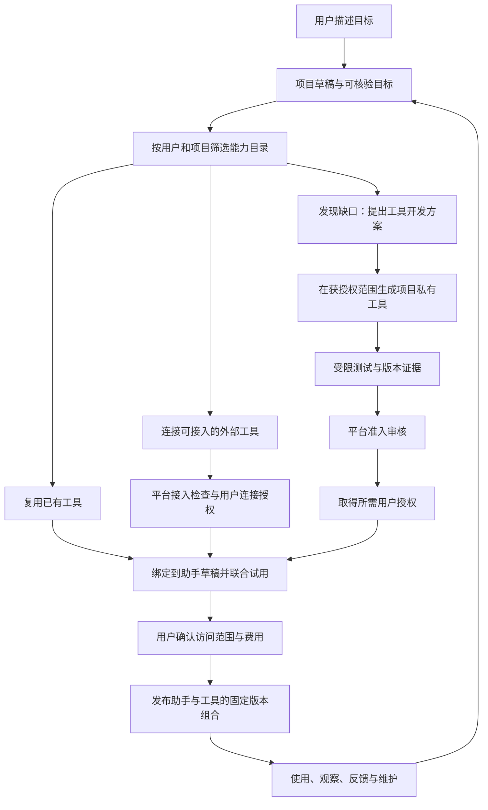
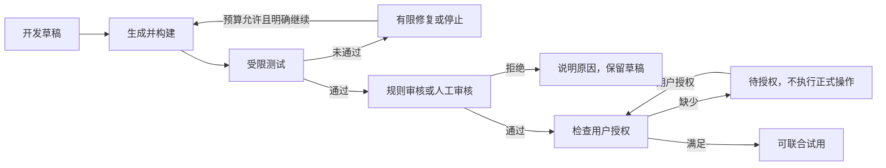

# 星桥总体设计

版本：1.4；日期：2026-11-08。依据[产品纲领 v1.7](product-charter.md)。这是当前目标设计，覆盖对话型助手、独立代码应用及自动开发工具。旧[体验设计](product-design.md)保留演进记录，历史模块实现见各自契约；本文不作为已上线或商业可用证明。

2026-11-07 更新：当前授权为[原生项目左侧详情体验版](p1-project-inspector.md)。原生 Projects 是唯一项目入口；项目列表、聊天标题与侧栏指向同一项目。资源浏览只改变左侧，中央对话与未发送内容保留；文件编辑、知识管理、设置和发布由明确操作打开可关闭的工作窗口；助手试用在新标签页启动，以保留创建对话。个人菜单“我的空间”管理全账号资产，项目文件视图限定已关联目录。原有绑定模型未扩展为任意多助手/多应用；空状态必须说明当前限制。自然语言创建和自动开发工具仍属目标设计，不把本轮界面改造当成它们已实现。

2026-11-08 当前增量：按[资源导航清单](p1-resource-navigation.md)分阶段实施。全局目录保留公共/个人/共享能力，项目只引用；唯一资料空间管理多知识库与工作文件等资产，知识检索工具选择明确集合；用量双环为磁盘与模型金额，tokens 为实际明细。知识编辑自动索引、可用助手目录与邀请接受、私有工具准入各自依赖后续契约，不视为现成功能。

当前用户授权增量为 [LLM 与工具反馈画布](p1-assistant-loop.md)。先更新设计，再实施与验收。右侧固定画布展示按需调用和结果反馈，保留独立对话。参数编辑与中央创建对话共享版本化草稿。此切片不开放任意连线，不将未接通能力显示为已执行。

## 1 产品主线与对象关系

星桥通过对话帮助用户创建、试用、修改、发布并持续维护应用。创建者可以交付一个对话助手、一个独立网站/后台/API，或两者组合；代码应用运行时不必调用 LLM。

项目是长期载体，组织目标、对话、文件、配置、知识引用、工具、试用、发布与运行记录。OpenHands 是开发执行者，不是与项目平级的业务成果；知识和工具是按需授权使用的能力，均非所有项目必选。

| 对象 | 产品职责 | 边界 |
| --- | --- | --- |
| 对话助手 | 基于行为指令、知识、Skill 和工具完成任务 | 正式运行时不能自行编辑源码、扩大权限或发布新能力 |
| 代码应用 | 交付独立页面/API、登录、业务账号、数据库和存储 | 应用账号不自动取得星桥账号、模型额度或开发权限 |
| 项目工具 | 为助手提供有明确输入输出的可执行能力 | 私有版本默认仅限本项目，调用权不等于源码或整个磁盘读取权 |
| 能力目录 | 记录平台审核过的模型、工具、Skill、RAG 和开发/运行能力 | 目录可发现、项目授权、实际执行是不同控制 |
| 开发助手 | 在获授权任务范围内生成和修改代码、测试、准备发布产物 | 与正式工具运行身份分离，不把开发环境的权限传给交付物 |
| 发布组合 | 固定主要应用及所选依赖的已确认版本 | 不复制明文凭据，不绕过实时授权和停用规则 |

代码应用保留完整主路径：描述需求 → 开发 → 可交互预览（含实际需要的数据库/登录）→ 修改 → 部署 → 地址、状态、日志和资源用量 → 后续更新、暂停/恢复、备份/导出及受控销毁。应用规格和持久存储按实际生效权益约束。停止计算不等于删除数据，代码回退不等于数据库回退。

## 2 自然语言创建与三种能力来源

普通用户描述“想完成什么”，不要求先配置 Prompt、Tool、Skill 或 RAG 参数。系统先形成可试用草稿，只有缺少资料、业务规则、授权或费用确认时追问。高级配置保留，但不作为默认起点。

三条能力来源按任务选择，不要求每次都走一遍。连接外部服务只能采用已支持、获审核的接入方式；“没有合适工具”可以触发开发建议，不能触发任意 URL/命令接入或绕过平台审核。外部供应商行为不由本平台完全控制，记录其接口版本/定义指纹与验证结果，不能承诺供应商实现永久不变。

开发方案用业务语言说明用途、输入输出、需要读取/修改什么、验收例子和费用边界。在已有授权范围内自动开发，范围扩大则重新确认。不另行部署一套 OpenHands 给每个工具；复用受控开发编排，执行资源按任务隔离和限额，具体运行方案须经工程契约验证。

## 3 管理员目录与生成工具的资产关系

Platform Control 管理“平台允许提供什么”，项目工作区管理“这个项目准备使用什么”。私人生成工具也要有平台可核验的登记与准入记录，但不因登记就公开到全平台列表；创建者不能自行修改审核结论。

管理员可以配置名称与用途、稳定 ID 和版本、支持范围、接口约定、数据去向、运行限制、费用规则、依赖、鉴权方式和可见范围。RAG 目录描述检索能力与支持格式，不公开用户全库；实际知识集合按用户与项目筛选。工具描述、Skill 内容和检索文档属于不可信输入，不能成为权限规则。

每个生成工具版本必须保留以下设计对象，实施时复用既有记录与契约，不在本文预先承诺数据库结构或接口地址：

| 信息 | 用途 |
| --- | --- |
| 项目/所有者、工具 ID、版本、来源 | 确认归属、访问与是否为生成/导入/外部能力 |
| 源码及构建产物摘要、锁定依赖、输入输出约定 | 保证测试、审核和执行针对同一产物；镜像固定摘要而非浮动标签 |
| 数据路径、账号范围、网络目标、读写副作用、资源上限 | 将业务用途转换为可实施的最小权限和额度约束 |
| 测试记录、策略版本、人工审核和用户授权引用 | 说明为什么获准使用，以及适用版本、环境和范围 |
| 试用/正式发布引用、运行状态、用量和审计 | 支持维护、追溯、停用和防止引用中的产物被误删 |

凭据只保存受保护的引用，不进入源码、构建参数日志、镜像、LLM 提示词或发布清单。开发测试使用合成数据或明确授权的测试资源；部署正式连接前再次确认环境与授权，测试授权不自动扩大为生产授权。

## 4 管理员审核、用户授权与执行确认

三层控制必须同时满足适用条件，任何一层都不能代替另一层。

| 控制 | 决定者与内容 | 有效性 |
| --- | --- | --- |
| 平台准入 | 管理员发布的确定性策略，或管理员人工审核；判断该工具版本在什么执行约束下可提供 | 绑定产物摘要、接口/权限声明、策略版本与适用范围；被撤销不能继续使用 |
| 用户资源授权 | 有权管理该资源的用户，明确连接账号、资料/数据范围、允许操作、环境与费用归属 | 可撤销；不能授权不属于自己的资源；预算承担不等于授予数据访问 |
| 单次操作确认 | 当前有权执行该业务动作的人，对具体目标、参数和后果确认 | 绑定调用者、应用/工具版本、参数摘要和有效期；参数改变、过期或已使用则不能复用 |

首批准入规则建议如下；实际阈值与支持范围在实施前配置并验收，未配置策略不能自动放行：

| 工具情况 | 平台审核 | 用户侧要求 |
| --- | --- | --- |
| 私有纯计算：无网络、无凭据、无持久写入，仅处理显式输入 | 可由管理员发布的受限执行策略与确定性检查通过，保留策略版本/证据；不明确则人工审核 | 在用户已授权的任务与额度内试用；输出文件保存由用户选择或明确任务授权 |
| 新增文件/数据库敏感读取或外部系统连接 | 首批人工检查准确版本、数据范围、网络去向与运行约束 | 明确资源与连接授权；数据库账号不能因同属平台而自动可用 |
| 创建记录、修改数据、发送消息等业务写入 | 首批人工审核，并验证副作用、可核验结果与幂等边界 | 资源授权之外，逐次确认具体写操作；不自动重试结果不明的写入 |
| 共享到平台目录 | 单独审核来源、许可、内容、依赖、用途与可见范围 | 所有者明确同意分享相应资产；不包含私人凭据和测试业务数据 |
| 跨租户访问、平台密钥、任意集群管理或其他禁止能力 | 普通生成工具准入路径拒绝 | 不能通过用户同意或普通管理员点击审核绕过隔离规则 |

生成代码本身是不可信的。自动准入必须依靠实际执行约束，不依赖 LLM 声称“纯计算”、代码扫描无告警或几个测试通过。LLM 可以给出风险建议，但无权授予权限、审批自身工具或把拒绝结果改成成功。

最终应用使用者只获得发布范围内的使用权。共享连接的代执行必须明确业务身份映射和允许的数据/操作范围，不能直接把创建者全部连接权限转交给受邀成员。管理员准入审核不默认开放私人聊天或业务数据；审核尽量使用代码、声明和合成证据，额外数据访问需有独立依据和审计。

代码、依赖、接口、网络目标或权限范围变化创建新工具版本，并重新执行适用审核、授权和试用。凭据轮换可以保留相同范围的授权引用，但不得改变主体/范围；连接失效或授权撤销时立即阻止新调用。

## 5 从开发草稿到可试用工具

开发任务、审核、授权、工具运行和应用发布分别记录状态；不能把工具“审核通过”显示成助手“已上线”。管理员审核不能因用户试用成功自动完成；拒绝后修改代码仍是新候选版本，不覆盖原审核记录。

测试至少覆盖输入校验、输出结构、可核验业务结果、异常/超时、资源限制与拒绝越权。工具测试后还要用助手的真实任务验证参数选择、结果解释和失败反馈；模型自评和工具单测都不能单独替代联合验收。

开发/构建/运行身份分离，运行工具只拿当前调用所需授权和资源；不得直接执行在 LibreChat 主进程或可信编排服务内，也不授予 Kubernetes 管理凭据。目标复用现有受限任务机制，具体 Kata 配置、网络和凭据注入必须在后续实施中重新验证，本文不凭组件存在宣称隔离通过。

开发、构建、测试、存储、模型与实际工具调用归入明确的项目和付款主体，按套餐限制时间、重试、并发及预算。额度耗尽停止新增执行并保留成果；审批等待不应无限占用计算资源。任何环境清理均只针对该任务登记的临时资源，不能把项目 PVC、源码或业务库纳入失败清理。

## 6 工具和助手一起发布的规则

### 一份组合清单，一次用户确认

助手发布记录固定：助手配置摘要、模型路由记录、Skill 版本、知识修订、每个工具的 ID/版本/产物摘要、必要运行服务版本、授权引用与范围、联合试用记录和费用承担。工具并非必须与助手打包进同一容器；纯配置助手也不因此被迫独立部署服务。

版本固定的是能力及约束，授权有效性在执行时重新验证。发布不复制密码，也不保证第三方模型或外部 API 实现永不变化；对这些依赖记录已验证版本信息与异常，必要时阻止继续执行。

### 准备完成后再切换

1. 创建持久、幂等的发布意图，记录当前草稿与组合摘要。重复确认同一意图返回原进度，不新建第二次发布。
2. 核验全部工具产物与审核证据、知识、依赖、有效授权、联合试用与配额；生成后又被修改的文件不能替换已审核产物。不可验证时阻止发布，而非仅给警告。
3. 按需准备候选运行资源并验证就绪；准备阶段不切换旧线上入口，也不执行未单独确认的业务写入或数据迁移。
4. 切换前再次核验草稿摘要、审核/授权状态及期望线上版本。只有整个组合通过才更新线上指向；发布期间并发修改或撤销导致重新核验，不覆盖他人的新发布。
5. 明确成功后展示正式入口与版本。部分失败保留旧组合；首次发布失败显示未上线。切换结果不明时按同一意图查询实际状态，不重放发布或业务操作。

这是产品层的可观察一致性要求，不预先声称跨服务事务原子。后续工程契约须定义状态机、并发控制、失败补偿、就绪观察和重试边界；不得用逐项更新线上对象实现半套新版本对外可用。

### 会话、升级、撤销和回退

新发布后新会话使用新组合；已有会话继续使用自己固定的版本，不在一次对话中偷偷换工具。旧版所需运行资源在承诺的保留期内保留并明确计费；若不再支持继续运行，提示开启新会话，而不是静默改绑。使用时仍校验最新的成员权限、工具停用、用户授权和预算。

工具或连接紧急停用立即阻止所有受影响版本的后续调用，并告知助手哪项能力不可用；保留不受影响的能力需要明确降级说明，不能伪造执行结果。已发出的外部操作可能仍完成，停止或撤销不等于撤回。

修改工具先形成新草稿，复核通过并重新联合试用后才能发布。回退只能使用仍获准运行、与当前业务数据兼容的完整旧组合；不可恢复已撤销权限，不自动回滚业务数据。正在被发布版本/保留会话引用的产物不得直接删除，取消与失败清理不能绕过引用和数据保留规则。

### 与已有契约的兼容边界

当前[管理员 MCP 契约](mcp-service-management.md)中，修改连接配置或重新检查会撤销旧版本，外部写入要求逐次确认；这些现行限制继续有效。本文的候选版本和联合发布是目标设计，不能在实现前将现有行为描述为“旧版始终可用”。版本化升级需单独兼容方案和回归证据，不能为实现新流程放宽现有公网网关边界或允许任意私网地址/stdio。

项目自建工具需要受控的私有执行入口，不把用户私有服务伪装成已审核的公网 MCP 服务，也不假定现有 MCP 网关已能运行生成代码。先验证执行、身份和授权契约，再接到统一的能力引用及发布流程。

## 7 界面如何引导用户

项目入口与个人空间分离：用户从项目列表新建/继续项目，唯一的“我的空间”放在个人菜单。取消右侧项目管理抽屉，管理入口归入 LibreChat 左侧侧栏，中央保留创建对话和显式切换的试用。改良原生构建器，逐步实现对话和高级设置操作同一份草稿；当前接线差异必须明确记录。知识资料管理在助手草稿需要知识后引导出现，临时附件和生成文件不强制进入知识库。创建者描述目标，平台给出“已准备”“待补资料”“待连接”“待审核”“准备失败”等真实状态和当前必要动作；不显示未实现的成功。

例如“报价助手”缺少折扣计算能力时，显示“正在准备报价计算”，完成后提供“试算一下”；需要订单账号时显示“连接订单系统”；需要管理员审核时显示待审核与原因，不能一直假装在生成。原始代码、详细日志、配置和审核依据放在按需展开的区域。用户可以拒绝开发、取消后续执行或先试用不依赖该工具的能力。

用户授权界面简洁展示：哪个项目/工具、访问哪个账号/数据范围、读还是写、是否允许受邀者在限定范围代执行，以及怎样撤销。逐次确认则展示本次具体业务动作和目标。发布确认集中展示版本变化、开放能力、使用者、费用与数据影响，不要求用户分别去工具页和助手页各发布一次。

管理员后台按“待检查 / 待审核 / 已准入 / 已停用”查看能力，查看来源、版本摘要、风险、证据、适用范围和受影响应用；批准、拒绝、停用、恢复均留审计。公开平台目录与私人项目审核不是同一个可见范围，不能为了审核方便公开所有私人工具。

## 8 失败、维护与实施边界

| 情况 | 必须表现 |
| --- | --- |
| 代码生成或测试失败 | 保留草稿，说明缺口，有限修复；不显示工具已可用 |
| 管理员拒绝或用户拒绝授权 | 明确未开放的能力，保留其他成果；不得换名/换入口绕过拒绝 |
| 工具审核后产物被替换 | 摘要不符，试用或发布拒绝，重新走版本流程 |
| 只读状态查询超时 | 保留上次确认状态与时间，自动重试查询；不宣称操作失败 |
| 写工具结果不明 | 保留调用标识与审批证据，按目标系统核验；无幂等或查证机制时不自动重放 |
| 联合发布部分失败/中断 | 旧版保持，按同一发布意图核验；只清理未被引用的候选临时资源 |
| 权限撤销或工具停用 | 拒绝后续调用，明确受影响能力；保留审计与数据 |
| 配额不足、取消任务 | 停止新执行并清理临时计算，说明已发生费用与保留成果；不承诺全部退款 |

恢复开发后的依赖顺序为：确认交互与支持范围 → 盘点复用目录/版本/执行契约 → 管理员准入与用户授权 → 私有纯计算工具完整切片 → 读连接工具 → 严格逐次确认的业务写入 → 共享目录与升级维护。每一步先通过用户任务、权限、计费和故障回归，再扩大范围；不在本次设计中宣布新的阶段已完成或承诺工期。

## 9 验收与交付边界

以下是后续验收目标，不是本轮测试成绩。使用合成数据和已授权测试身份，记录环境、代码/工具产物摘要、模型、策略、调用 ID、实际结果、费用、失败和人工介入。

| 编号 | 用户任务或故障 | 通过条件 |
| --- | --- | --- |
| AT01 | 目录已有能力 / 缺少能力 | 优先复用真实目录；缺口明确，不编造工具，不强制每次编程 |
| AT02 | 自然语言创建报价助手及计算工具 | 在既定预算内生成私有工具，以确定的计算样例核验结果，助手实际调用；未写手工工具配置也能完成 |
| AT03 | 纯计算规则审核 / 不明确的风险 | 记录策略版本和执行限制；测试网络、文件和凭据边界；不能仅凭 LLM 自评自动通过 |
| AT04 | 管理员通过、用户未授权，或反之 | 两种情况都不能调用需要授权的资源；直接接口同样拒绝 |
| AT05 | 修改代码、依赖、Schema 或构建产物 | 原审批与验收不能覆盖新版本；发布前摘要检查阻止替换 |
| AT06 | 工具与助手组合发布；并发修改/撤销 | 仅切换完整已验收组合；部分失败保持旧版；首次失败不显示成功入口 |
| AT07 | 工具从 v1 更新到 v2 | 草稿试用新工具，正式 v1 不受草稿影响；发布后新会话用 v2，旧会话版本可解释 |
| AT08 | 撤销连接/成员、停用工具、回退版本 | 后续执行拒绝；旧会话和回退不能恢复权限；不承诺撤回已发出的外部写入 |
| AT09 | 业务写入超时和重复确认 | 同一操作的确认与调用身份可核验，参数变化不得复用批准；未知结果不盲目重放 |
| AT10 | 成员使用、预算与数据范围 | 不取得创建者全量连接权限、源码或其他项目资料；开发与正式调用费用主体正确，无重复扣费 |
| AT11 | 取消、失败清理、删除引用中工具 | 清理临时计算，保留源文件和业务数据；发布/会话引用阻止误删 |
| AT12 | 项目私有工具申请平台共享 | 单独审核和分享授权；无私人凭据/数据泄露；私人可用不等于公开可用 |
| AT13 | 两类应用的组合与独立交付 | 代码应用能独立试用/部署/运维；对话助手可无自建工具交付；不互相强制安装无关能力 |

另需按纲领完成多身份、多日重复、性能、真实用户无协助使用及恢复门槛。当前已有聊天、编程、MCP 管理和发布模块只是复用基础；上述自动开发工具流程尚未实际执行。本轮界面迁移的测试与部署另见[左侧项目工作区](p1-project-sidebar.md)，不能作为 AT01—AT13 的通过证据。

## 原生 Projects 合并（最新决策）

项目导航以 LibreChat 原生会话侧栏为唯一入口，星桥应用资源通过所有者校验的稳定引用挂接；不保留第二套项目列表。已有数据不迁移删除，导入不得覆盖同名项目。详情顶部展示账号级资源摘要，普通聊天独立；创建、修改与私人试用会话归档到对应项目，正式受邀会话与创建项目隔离。具体执行与验收见[合并清单](p1-project-unification.md)。

2026-11-07 实施状态：上述原生 Projects 关联与账号资源摘要已部署，助手试用/发布和代码目录/文件路径已有 UI 证据，详见合并清单。多轮自然语言构建、任意能力目录生成草稿及工具联合发布仍属目标，不因入口合并自动完成。
