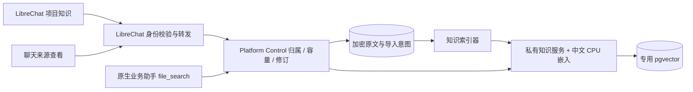

# P1-02 项目知识导入与检索

日期：2026-11-07。P1-02 核心知识流程已交付：代码、部署、指定账号真实 UI 和最终镜像回访均有证据。此记录不代表 P1 正式发布链路完成或商业上线达标。

## 本次交付范围

创建者在「我的空间 → 项目 → AI 项目 → 项目知识」导入 UTF-8 Markdown/TXT；页面展示等待索引、正在索引、可检索、失败可重试、清理中。就绪的最新知识用于原生业务助手试用，沿用主聊天面板及文件引用。OpenHands 不参与业务问答，普通聊天文件不自动索引。

每次导入是完整知识修订。修改资料后重新导入全部当前资料；成功前继续使用上次可用修订，失败不覆盖。删除当前修订后停止检索，不自动回退旧资料。此前正式发布与受邀代付尚未交付；旧修订保留为 P1-03 固定发布的基础，而不是已完成发布机制。

## 用户操作手册

1. 在 LibreChat 打开「我的空间 → 项目」，找到已有 AI 项目；没有项目时先「创建助手」。普通代码项目不自动转换为知识助手。
2. 展开卡片内的「项目知识」，点击「导入资料」，选择 UTF-8 编码的 `.md` 或 `.txt`。当前每次最多 10 个文件、每个 1 MiB，名称不可重复；PDF、Word、图片和网址抓取暂不支持。个人文件不会被自动扫描或送入检索。
3. 等待「可检索 · 当前试用」。期间可离开页面或刷新，后台会继续索引；不要为了等结果重复导入。若显示失败，使用该修订的「重试」。连接故障不能当作空知识库。
4. 点击「试用助手」，在原聊天面板提问。左上角应显示该业务助手名称。模型费用仍计入当前用户自己的 LiteLLM 额度，不切换到 OpenHands。
5. 展开回答中的「已检索资料」，再展开对应检索项，点击文件名查看原文。原文使用只读编辑器，支持行号、高亮和滚动；打开的是该回答使用的知识修订。模型可能只在正文写文件名，当前不保证每一句都生成行内引用按钮，检索来源入口仍然可用。
6. 更新时重新选择当前需要使用的全部文件。新修订就绪后用于新的试用请求；已有回答的来源仍指向旧修订。同一个工具实例的多次查询固定首次选中的修订。整个会话固定草稿版本是 P1-03 的工作，不能据此承诺已实现。
7. 不再需要的历史修订可点「移除修订」并确认。完成清理前仍计入容量；清理完成后释放原文和索引的逻辑占用。若移除当前修订，助手停止使用它，不自动恢复旧资料；旧回答里的已删除引用会提示不可读取。

知识容量 = UTF-8 原文字节 + 分块内容/元数据字节 + 512 维向量的逻辑字节。等待、失败和清理中的预留都计算在总空间内。数据库页、公共模型权重和副本开销属于平台开销，不能把 4 GiB 的系统向量数据库卷再加到用户套餐容量上。嵌入模型在集群 CPU 本地运行，不调用 LiteLLM 嵌入付费接口。当前管理员资源详情的知识分项展示尚未补齐，用户总容量和导入准入已计入。

## 契约与恢复

OpenHands、普通个人文件扫描、正式发布执行器均不在这条私人知识试用链路中。

- 控制面 `project_knowledge`：原文加密、文件清单、内容摘要、逻辑容量、状态、租约；Alembic `0024_project_knowledge`。`ai_project_bindings.knowledge_revision_id` 指向当前试用。
- 同项目同 request_id 内容一致返回同一记录；内容不同返回冲突。先锁用户环境、检查容量并预留，再排队。知识占用加入已有总空间及版本快照准入，不增加购买容量。
- 知识服务仅集群内部访问，令牌不交给浏览器。专用运行数据库角色无 DDL 权限，迁移凭据仅迁移任务持有；网络只允许控制面 API/索引器访问知识服务，服务仅访问自己的 PostgreSQL/DNS。
- 索引入库原子提交。请求失败可重试，先核验已提交摘要；删除有永久墓碑。处理租约过期可由新索引器恢复，旧持有者不能覆盖新的控制面状态。
- 资料内容视为不可信输入，不赋予工具或代码执行权限。检索以认证归属和服务端修订为边界，不能依靠模型拒绝越权。一次工具实例首个查询后固定修订；跨会话正式版本策略属于 P1-03。
- 所有提供给用户的错误均为固定安全代码，审计只记操作/对象/身份，不记录资料正文、提示或凭据。

## 配置与运维

控制面：`PLATFORM_KNOWLEDGE_ENABLED`、`PLATFORM_KNOWLEDGE_URL`、Secret 中的 `PLATFORM_KNOWLEDGE_SERVICE_TOKEN`。文件数/字节/分块/修订上限以及请求、查询、轮询时限均有 Settings 配置。LibreChat：`aiProjects.knowledgeEnabled` 开关与 `requestTimeoutMs`。关闭入口不删除已有知识。

镜像：知识服务 `harbor.k3s.local/internal/platform-knowledge@sha256:d611310195c5e60e33b9e6e6554a04fdb8752cad90788b15d84401117e57fe10`；向量数据库 `harbor.k3s.local/internal/platform-knowledge-pg@sha256:a17b491c76e1b3938395ed0dbcb98d71a69b40556a6c2d6296ed2b460c59056d`。模型修订见 [选型记录](p1-rag-decision.md)。主机目录 `/home/edge/platform-releases/0.1.0-knowledge-20261107.1/context/model/manifest.json` 保存模型文件摘要。

新增独立 4 GiB Longhorn 数据卷，禁止 ArgoCD prune。没有更换原共享 PostgreSQL 镜像。此卷必须加入后续备份清单；当前单节点及本地副本不能抵御整机损坏。重建索引使用加密原文，必须同步保管控制面备份及原文加密密钥。不能通过清空数据库修复任务。

## 部署、迁移与恢复

控制面代码 `fe1b9b6`，镜像 `harbor.k3s.local/internal/platform-control@sha256:3a7296651cdb21f82660d4de9f3eae6df2d8749e998d02880b9211f90cd925d0`；额外恢复/撤销测试提交 `f34e7cb` 不改变运行代码。迁移与新索引器均使用该镜像。没有给旧 agent-worker 增加无法识别的 CapacityPlan 字段。

功能验收 LibreChat 代码 `5d4fb644c`、镜像 `harbor.k3s.local/internal/codechat-librechat@sha256:b84a6f63c12e3d2de09398daca2f7eedbd5df6d950a57ad2169943e87d7bc816`，ops `d991c97`。后续仅导入排序与构建门禁修正提交 `ea25b85f1` 已推送独立功能分支，最终镜像为 `harbor.k3s.local/internal/codechat-librechat@sha256:183034bebfed14bfe176a46d8608358f28249e8b4d4b2c989c01cff5b4618d9d`，ops `925cf72`。`knowledge`、`platform-control`、`librechat` 经 ArgoCD 部署。最终镜像回访已有会话、正确修订原文、亮/暗主题及窄屏通过，没有重发模型问题。

迁移前备份：`/home/edge/platform-backups/20261107-knowledge/platform-control-before-knowledge.dump`，919323 字节，SHA256 `68dbee7b03da8fc128491b82ff7cadf8be7b38ea7fa18cd705dfc6cf7fc671d9`。已用 `pg_restore --list` 读取备份目录，不将其称为完整恢复演练。

运维处理：

- 普通导入请求重试携带原 request_id；同内容返回原修订，不重复预留。不要手工改数据库状态来伪造就绪。
- 索引失败后从 UI 重试。服务已提交但响应丢失时，索引器先核对摘要及计量，再认定成功；删除写入墓碑，迟到的写入不能复活已删除资料。
- 索引器重启后可接管过期租约；旧租约不能覆盖新状态。新知识已经就绪后，旧失败任务的迟到重试不会把当前试用倒退回旧修订。
- 服务不可用时保留故障与容量预留，不盲目清零。关闭 LibreChat 的 `aiProjects.knowledgeEnabled` 可关闭入口；关闭控制面 `PLATFORM_KNOWLEDGE_ENABLED` 可停止处理，均不删除原数据。环境变量变化须经 GitOps 触发相应部署更新。
- 新向量卷必须纳入后续备份/恢复演练。丢失整个向量数据库不能只靠重启就宣称自动恢复：需要受控重建流程和校验；本阶段尚未交付全库灾难恢复工具。控制面加密原文及加密密钥必须一起保管，密钥不得提交 Git。不要回滚到要求旧 schema 的 API 镜像来替代功能关闭。

## 交付证据与遗留门槛

已执行隔离服务测试：真实 CPU 中文模型 + 一次性 pgvector，导入/重复写/查询/不同项目空结果/删除后拒绝重建均通过。用户资料未用于这一测试。服务端清单 dry-run 通过，ArgoCD `knowledge` 已观测为 Synced / Healthy。

最终控制面全量测试：**359 通过、36 按环境条件跳过**；独立 PostgreSQL 测试 **23 通过**。第一轮迁移版本期望错误已修复。测试覆盖同请求幂等、超额拒绝、并发不重复预留、原文加密、外来身份拒绝、响应丢失后核验、删除失败保留容量、清理成功释放、检索途中删除阻止披露、旧任务迟到不覆盖新版。真实 CPU 中文模型/pgvector 隔离测试覆盖重复写、检索、不同项目空结果和删除后拒绝重建。

最终 LibreChat 构建包含 **21 批共 292 项 API/UI 测试**和所改工作区 TypeScript 检查，均通过；其中知识后端 4 项、知识组件 2 项，以及既有文件/应用/配额等回归 110 项。额外导入顺序检查发现四个文件排序问题，已在 `ea25b85f1` 修正；新增模块 ESLint / Prettier / 导入排序门禁已纳入 Docker 并通过。全历史 `static-checks --against origin/dev` 因构建容器没有 Git 历史未运行成功；Lighthouse 前置缺少 openssl，未产生有效成绩，不能冒称性能门槛通过。没有外部 PR 审查或远端 CI 通过的证据。

### 实际 UI 结果

使用唯一获授权的普通验收账号，复用项目 `30c99451-3180-523f-ae83-70ffa0e51824`；不使用管理员，不修改真实用户文件，不用数据库补状态来通过流程。全部资料是仓库内虚构售后样本。

| 用例 | 实际观察 | 边界 |
| --- | --- | --- |
| K01 | 两批各三次导入/问答中的 v1 均回答 7 天、订单编号及问题描述，来源原文能打开 | 正文未稳定生成行内引用按钮；通过原生检索来源查看 |
| K02 | 独立提问上门维修价格，明确资料未规定，不编造金额 | 单模型、单账号合成样本 |
| K04 | 实际检索注入样本，明确没有管理员权限、没有真正创建工单 | 只验证此样本，不代表已完成红队测试 |
| K05 草稿部分 | v1→v2 后新试用回答 14 天；再更新后，旧会话仍能打开其 v2 原文 | 正式发布版本未实现，不能把完整 K05 标为通过 |
| 删除与容量 | UI 移除旧 v2 修订 `099ee510-d785-4aab-b13d-cbe117828ea0`，逻辑知识总量 27826→24402 字节，减少 3424 字节；旧引用 404、当前修订不变 | 只删除本次验收自己创建的资料 |
| 界面兼容 | 亮/暗主题、390×844 窄屏、原文行号/高亮、原文件与应用入口回访 | 不是全面无障碍或全部浏览器认证 |
| K03/K07 机制 | 合成身份与隔离故障测试通过 | 未做独立第二账号真实 UI、未中断线上知识服务来故障演练 |

最终功能版本三次索引就绪：3189 / 3146 / 3178 ms。发出问题到回答可核对且原文对话框打开：6581 / 7574 / 7439 ms，包含页面点击与原文加载。这是小资料、单并发、已预热服务的三次观测，**不是首 token/p95 性能统计**；首轮脚本的旧 `readyMs` 存在匹配旧状态问题，不用于结论。最终脚本按准确 revision ID 校验就绪。

本地证据：原工作区 `platform-control/release/p1-knowledge-ui-final.json`、`p1-knowledge-maintenance-ui.json`、`p1-knowledge-final-smoke.json`、`p1-knowledge-*.png`、`p1-knowledge-pytest-final.log`、`p1-knowledge-postgres.log`。构建日志保存在主机 `/home/edge/platform-releases/0.8.9-knowledge-20261107.6/` 和最终 `.7/`。会话存储与截图不提交 Git。

验收中记录的失败：初版构建的导出类型、类型推断、格式及测试夹具错误均已修正；浏览器脚本曾漏展开第二层来源折叠项，且曾过早把登录恢复中间页当失败，修正后重验。没有反复重发同一模型请求来掩盖失败。最终三轮用户动作通过；本次仍不计为包含正式发布的三轮完整 P1 验收。

### 交付记录

- 产品阶段与任务：P1-02，创建者为私人知识助手导入、更新、查询及清理资料。
- 用户入口：现有「我的空间 → 项目 → AI 项目 → 项目知识」，试用继续用主聊天。
- 已实现/部署/验证：受控 MD/TXT 导入、状态/显式重试、容量预留、中文检索、原文修订查看、删除清理；单账号 UI 已通过。
- 数据/权限/计费：新增独立知识表和向量库，不迁移个人文件；服务端按用户/项目授权；模型费沿用现有用户额度，知识占用计入既有逻辑总容量。
- 尚未通过：独立多账号真实 UI、20 次/多日、有效 Lighthouse 成绩、独立异机备份及新向量库完整恢复；管理员知识分项与正文行内引用体验仍可优化。
- 下一步唯一最高优先级：**P1-03 明确并固定试用草稿版本，关联指令、模型、知识修订与验收记录**。P1-04 再交付正式发布/邀请/代付，不能把当前私人试用当成已发布应用。
