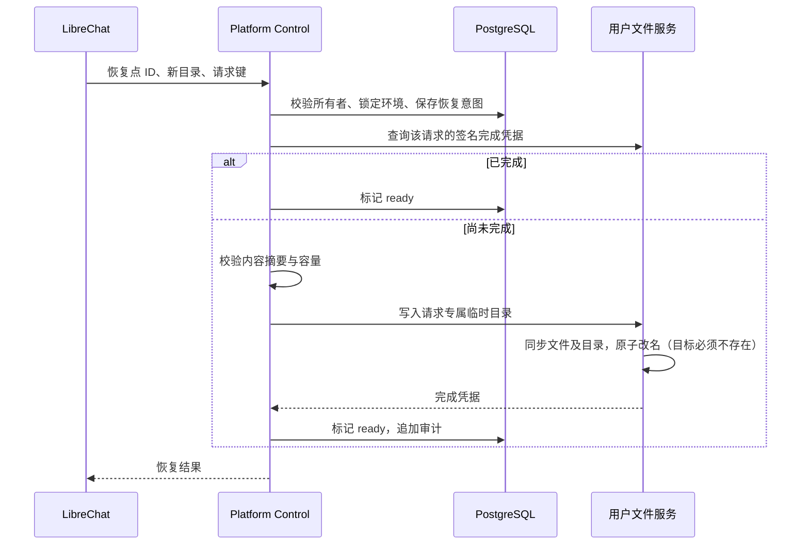

# 工程版本历史与恢复

本功能对应可靠性路线图的阶段 1C。源码恢复点独立保存，用户当前工程被修改后，历史内容不会跟着改变。它不替代完整卷备份或异机容灾。

## 用户使用

1. 打开 LibreChat「我的空间 → 文件」，在文件树中选择工程文件夹。
2. 点击工具栏「版本历史」，输入名称并创建恢复点。建议在大幅修改代码前创建。
3. 修改文件后，选择「查看差异」：显示新增、修改、删除；小型文本文件显示逐行差异，二进制或较大文件只显示变更状态。
4. 点击「恢复」，输入一个尚不存在的新文件夹名称。平台在个人空间根目录创建恢复副本，保留当前工程。恢复不会重新部署应用，也不会恢复运行中的数据库。
5. 如果提示恢复结果未确认，点击「核验并重试」。刷新页面后仍能找到该请求；系统先核对已有结果，再决定是否执行，不会覆盖已有文件夹。
6. 不再需要的恢复点可以删除，释放其容量。删除恢复点不删除原工程或恢复出来的文件夹。有尚未核验的恢复请求时，需先核验再删除。

聊天面板不切换、不重建；版本管理在文件区弹窗中完成。恢复后文件树和容量自动刷新。

## 范围与上限

- 每个恢复点最多 **4 MiB 源码、1000 个文件/目录项**；每位用户默认最多 **20 个恢复点**。这些限制保护共享控制面，独立于套餐磁盘上限。
- 默认排除 `.git`、`.cache`、`node_modules`、`.venv`、`__pycache__`、`.pytest_cache`、`dist`、`build`，以及文件服务不允许读取的链接、特殊文件和内部临时条目。用户原有 Git 仓库不会被初始化、改写或删除。
- 普通隐藏配置文件会被保存；用户应将不希望纳入版本的凭据放到平台凭据管理中。
- 创建与比较期间进行两次内容/文件版本扫描，发现变化即拒绝。用户存在活跃编程任务时，创建、比较和恢复暂不可用。人工文件写入与恢复使用同一用户环境锁。此机制不宣称提供任意外部进程写入下的文件系统原子快照。
- 历史按压缩、加密后的实际内容字节计入逻辑空间的「版本历史」分项；恢复副本计入普通文件用量。数据库索引、WAL 等平台内部开销不作为用户文件容量计费。
- 新建/恢复会检查已观测的逻辑用量，源卷仍受物理上限约束。其他服务未完成计量时，现有 `complete=false` 语义保持不变；这不代表跨 PostgreSQL、对象存储、镜像仓库的统一强制物理限额已经完成。
- 版本历史不静默淘汰。超额时用户自行清理或升级套餐；数量上限仍由管理员的服务配置控制。

## 存储设计

首版面向单节点、内部用户的小工程，将规范化源码清单压缩并使用平台加密密钥加密，保存在 PostgreSQL `project_versions`，元数据和内容在同一事务中提交。与用户可写目录分离，避免历史随工程被误改。上限限制了控制面请求和数据库负载。

这是有意限制规模的实现，不能扩大到任意大型工程。后续可把内容搬到平台专有对象桶，并保留数据库中的不可变清单/摘要；需要额外处理上传事务、垃圾回收、桶权限、加密和备份，不直接复用用户有写权限的桶。

`project_restores` 记录恢复意图、目标、状态和请求键。恢复流程：

完成凭据用文件服务密钥签名，绑定请求 ID、目标与内容摘要。成功响应丢失时，重试通过凭据识别已经完成的操作。相同请求键不能换目标或版本。

异常写入的临时目录立即清理；进程被强制终止留下的请求专属临时目录，在该请求重试时回收。尚无定期扫描所有中断临时目录的后台任务。服务密钥被轮换或完成凭据被删除/修改后，已有目标不会被自动覆盖，需要管理员核验，或选择新的目录。

审计动作：`versions.created`、`versions.restore_requested`、`versions.restored`、`versions.deleted`。审计只记资源 ID，不记录源码、文件内容或用户凭据。

## 配置与上线顺序

- `PLATFORM_PROJECT_VERSIONS_ENABLED`：默认 `false`，上线验收后启用。
- `PLATFORM_PROJECT_VERSIONS_LIMIT`：默认 `20`，允许 `1..100`。
- 迁移版本：`0019_project_versions`。先执行迁移及授权，再部署兼容 API 与文件服务，最后启用入口。
- API 角色需 `project_versions` / `project_restores` 的 SELECT、INSERT、UPDATE 权限；删除采用软删除并清空密文，不需要给用户数据库访问权限。
- 同时备份 PostgreSQL 和单独保护的平台加密密钥。只有数据库备份、没有密钥，不能解密历史内容。
- 功能开关可关闭新增访问而保留数据。已有历史时，降级迁移会拒绝丢弃表；不得用删表方式回滚。

## 验证依据

`tests/test_project_versions.py` 使用真实文件服务和控制面接口验证创建、差异、恢复到新目录、容量、审计、越权、同请求重试、响应丢失、源文件变化及路径穿越。PostgreSQL 并发测试验证多个请求只能占用一个剩余恢复点名额。

LibreChat 桥接测试验证身份来自已登录用户、只转发固定接口、错误信息不泄露内部响应；界面测试覆盖选中目录、错误提示、创建、差异及待核验请求重试。真实上线验收结果另行记录，不能把本地测试视作线上完成。

2026-11-06 本地/构建验证：恢复点与文件服务/容量测试 23 项通过；一次性 PostgreSQL 测试 16 项通过（含新并发检查）；LibreChat 镜像内 216 项测试及类型检查通过。完整 Python 首跑因本地缺少 jsonschema 有 7 项失败，安装已有离线缓存依赖后，受影响的 MCP 两个测试文件共 28 项全部通过，其他首跑 267 项通过、30 项跳过。

本地恢复演练使用迁移 `0019_project_versions`，4 个合成文件哈希匹配，用户身份与权益恢复成功，独立备份的密钥能解密凭据及源码恢复点，恢复到新目录成功；耗时约 7.17 秒，不能作为生产 RTO。

Windows 本机的 `npm run lighthouse` 在准备步骤被缺少 `rimraf` 命令阻断，未取得性能预算结果。Linux 镜像内的构建、类型检查和功能测试已通过，但不替代 Lighthouse 性能检查。
