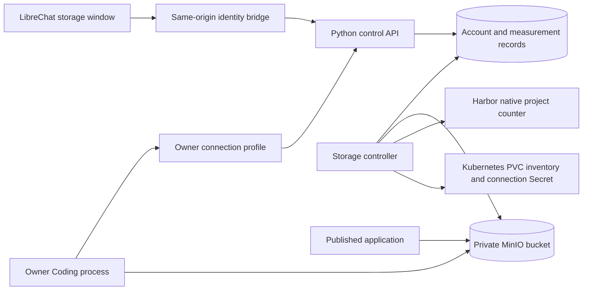

# Managed logical storage accounting

The account covers five distinct components: personal files/caches, managed
PostgreSQL databases, private object storage, the owner's Harbor project, and
additional application volumes. It is a logical account, not node disk usage.
Infrastructure replicas, backups, WAL, shared base images, temporary build layers
and incomplete uploads are outside this scope. Existing file rights are retained.
Category limits apply separately; they are not interchangeable storage credits.
The displayed total allowance (`storage.budget_bytes`) is the activated plan's
`storage_gib * 1024**3`, never the sum of category limits. `budget_complete` is
true because this entitlement is known, even when a provider's category cap is
unknown or unlimited. Measured usage still sums fresh samples from all five
components; `complete` independently reports measurement completeness. Pending
upgrades do not increase the total until the new plan is activated. This display
rule does not implement a cross-provider hard write limit.

Harbor uses the verified project's native quota counter, never the sum of image
sizes. The project numeric ID and private owner binding must match. A provider
counter is not a measurement of physical registry disk or garbage-collection
overhead. Its native finite limit is displayed as its category allowance.

MinIO allocates one private bucket per personal environment, automatically after
the existing workspace is ready. Generation tags seal ownership. A non-root
provisioner creates a restricted child access key and a 256 MiB test bucket quota;
root credentials are used only in the operator bootstrap. Application/agent
profiles receive only that child's credentials. Object payload accounting sums
completed object versions, with bounded scans; incomplete multipart uploads are
temporary resources and excluded. Application stop/failure/deletion retains
object data. No destructive object/bucket lifecycle action is added in this phase.

The existing applications do not allocate additional PVCs. A complete, verified
PVC inventory containing only the recorded personal PVC establishes zero extra
application-volume allocation. Any unknown extra PVC, truncated inventory, missing
personal PVC or UID mismatch makes this component unknown, not zero.

`GET /internal/v1/workspace/capacity` retains its component list and adds source,
scope, budget and service-state explanations. Only fresh valid samples enter the
measured subtotal. Complete is true only when all five managed components are
fresh and known. A failed provider read retains the previous sample as stale;
absence of a sample remains unknown. Reading the account never calls Harbor or
MinIO with administrative credentials; background controllers gather samples.

`GET /internal/v1/workspace/object-storage` returns public bucket lifecycle data.
The agent equivalent `/agent/v1/object-storage` is owner-key authenticated;
`GET /agent/v1/object-storage/profile?path=` delivers a no-store child profile
only for the owner's existing project directory. No browser profile route exists.
The next publication of that project receives its connection Secret and prefix;
existing running applications are not restarted just to add object storage.

Real money, object/image allowance upgrades, a single interchangeable hard byte
quota and additional application-volume provisioning remain outside this phase.

## Runtime and deployment

The dedicated storage-controller provisions buckets and gathers provider samples;
application-controller continues to own publication. Both use the existing
verified per-user namespace RoleBinding. The object provider credentials belong
only to storage-controller. API and agent profile responses never contain the
root or provisioner identity; only the owner-scoped child key reaches project
processes and application Secrets.

Schema revision is 0013_storage_providers. Downgrade refuses to erase recorded
object ownership. The worker database role needs capacity for four background
services plus rollout/probe connections; bootstrap now sets 16. Each background
process uses pool_size=1 and max_overflow=1 in GitOps. API keeps its separate
role/budget and default pool. Existing managed deployments can run
scripts/configure_worker_connections.py to increase only this connection budget;
it verifies the managed database owner and non-privileged role, and does not
rotate passwords or lower a custom larger limit.

The current MinIO endpoint is cluster-internal HTTP on port 9000. No public S3
ingress is introduced. No automatic expiration of completed objects or versions
is configured. Incomplete-upload recovery is owned by MinIO, not the completed
object byte counter; cleanup timing was not measured in this acceptance.

Provider references: [Harbor project quota semantics](https://goharbor.io/docs/edge/administration/configure-project-quotas/)
and [MinIO Python SDK](https://github.com/minio/minio-py). The installed server's
actual IAM and version behavior was separately checked in a disposable container
with the same image; the Postman mocks do not establish IAM enforcement.
